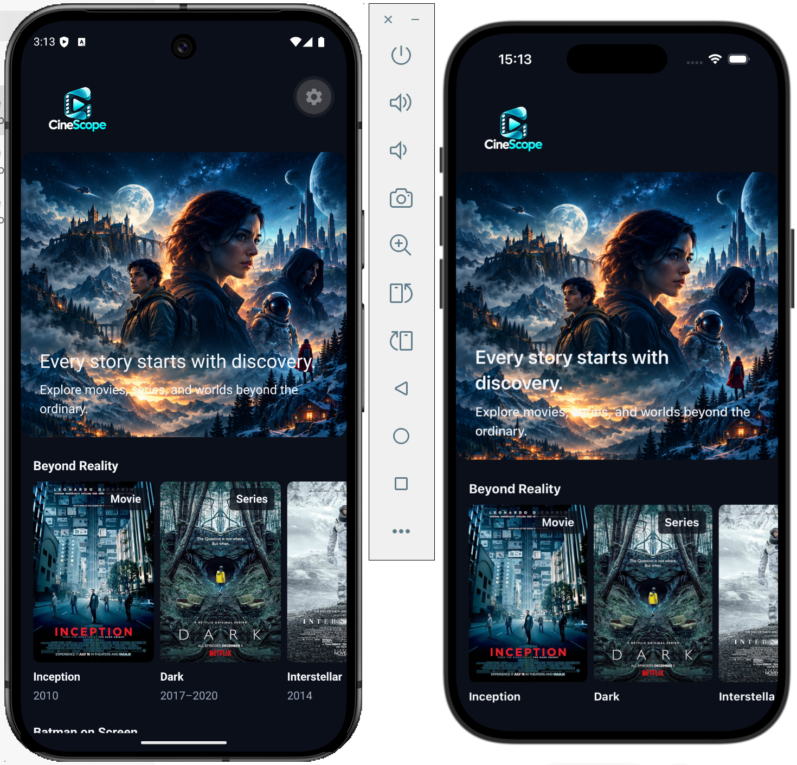
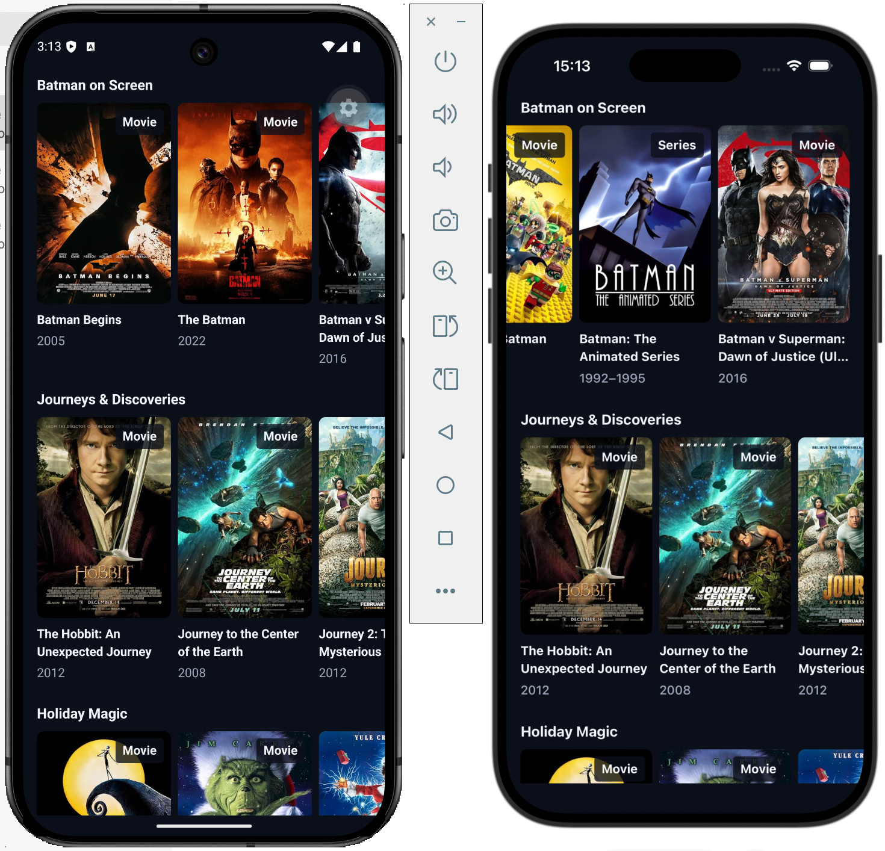
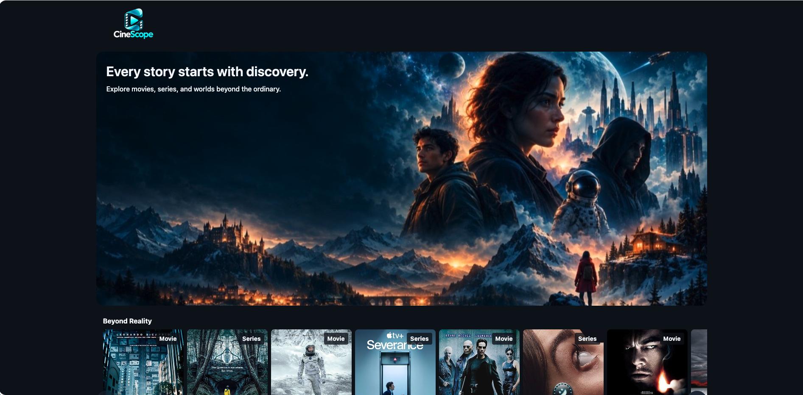
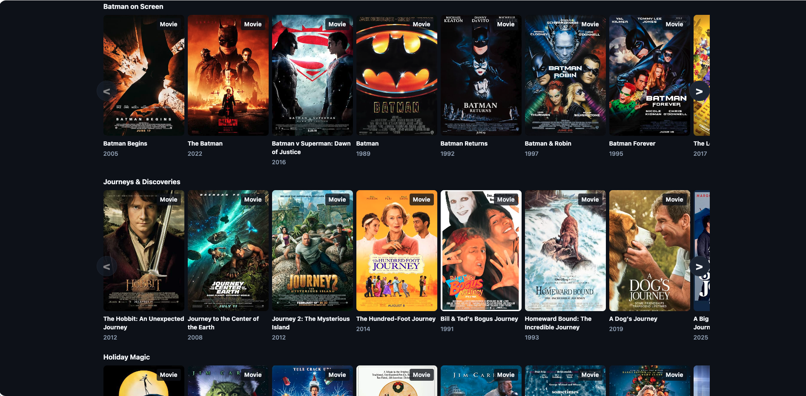
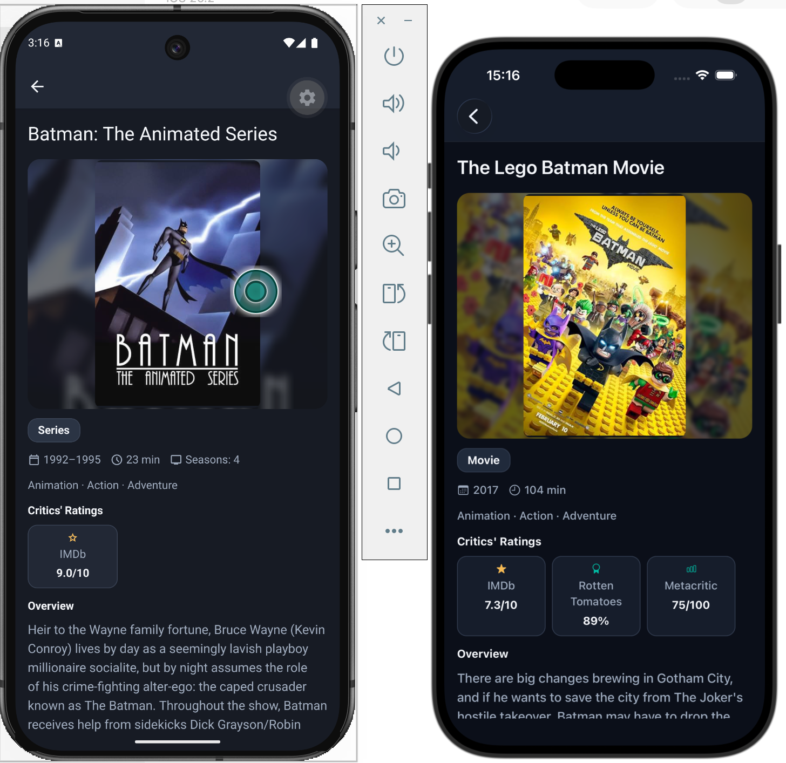
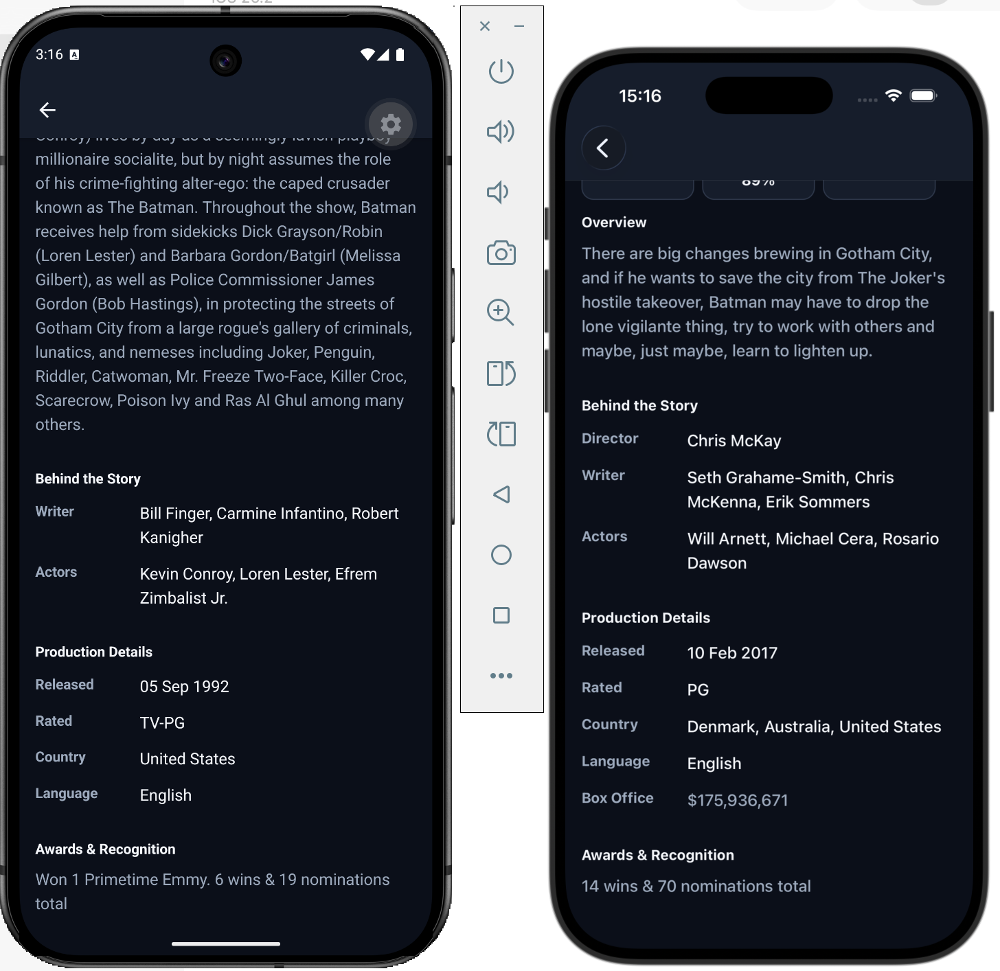
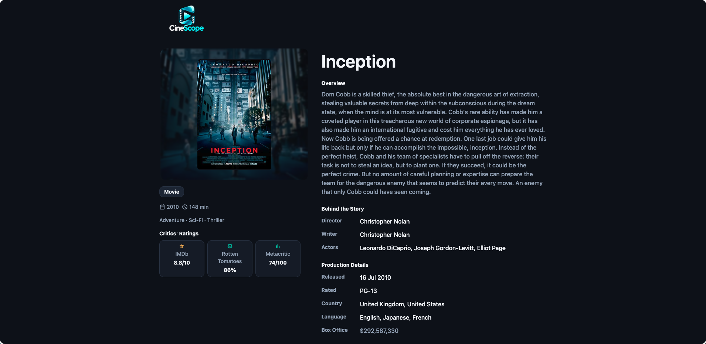
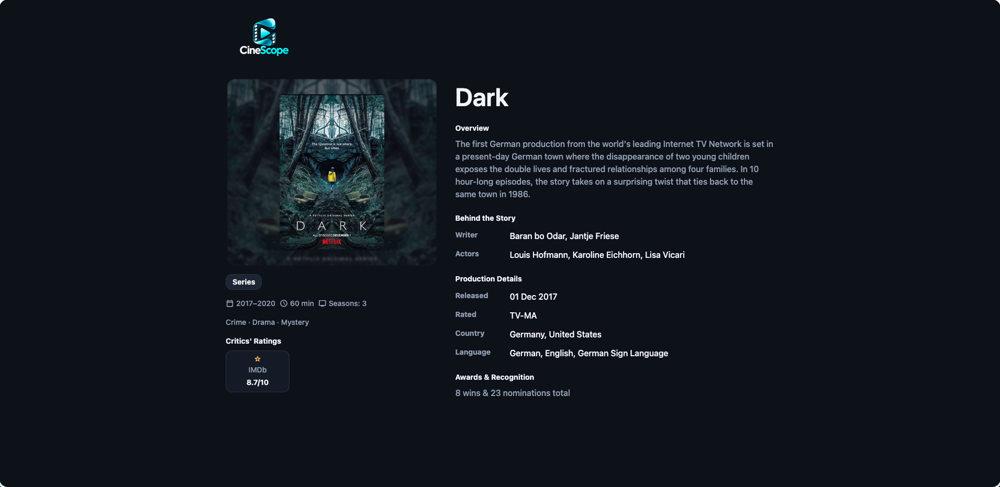

# CineScope

CineScope is a Netflix-inspired media discovery app built with Expo,
React Native, and TypeScript for iOS, Android, and Web. Browse mixed
movie and series collections, then open a shared Media Details screen
with live metadata from the [OMDb API](https://www.omdbapi.com/).

## Screenshots

### Home

**iOS / Android**

Two scroll positions of the same Home screen: the banner and the collections below.





**Web**





### Media Details

**iOS / Android**

Two scroll positions of Media Details, showing a series on Android and a movie on iOS.





**Web**

Movie and series examples using the shared Media Details screen.





## Features

- Dark Midnight Teal design with a responsive cinematic banner.
- Vertical collection browsing and horizontal media rows. Overflowing
  Web rows include keyboard-accessible previous/next controls; native
  rows support swipe scrolling.
- Movie and Series labels, poster fallbacks, and loading skeletons.
- Independently fetched collections with empty, error, and retry states.
  Cached content remains visible if a background refresh fails.
- Live Details by IMDb ID, including a layered poster, plot, metadata,
  critics' ratings, credits, and optional production information.
- Native Stack Back navigation; on Web, the CineScope logo links to
  Home. Native direct entry without Back history also offers the Home
  logo link. Invalid Details IDs are handled without an API request.

### Collections and data

Home displays these collections in order:

1. **Beyond Reality** — eight locally stored OMDb summary snapshots.
2. **Batman on Screen** — live title search for `Batman`.
3. **Journeys & Discoveries** — live title search for `Journey`.
4. **Holiday Magic** — live title search for `Christmas`.

Search collections use page 1, allow movies and series, exclude standalone
episodes, deduplicate IMDb IDs within each row, and show up to ten cards.
These are title-based collections, **not trending, popularity, or
genre-discovery rankings**.

Beyond Reality uses static metadata and remote poster URLs, not bundled
poster images. Its visible titles, years, and type labels show placeholders
until all initial Search queries settle, including failures. This is an
intentional presentation choice, not a check that poster images have loaded.
Retries do not hide the metadata again.

Home does not fetch Details per card or seed the Details cache with curated
snapshots. Selecting a card passes only its IMDb ID; Details fetches live
data independently. OMDb responses are validated and mapped into domain
models, including handling unavailable or malformed optional metadata.

## Technology

- Expo, React Native, and React Native Web.
- TypeScript with strict checking.
- Expo Router with Stack navigation.
- TanStack Query for caching, request deduplication, and query lifecycle.
- Native `fetch` for OMDb requests and cancellation.
- `expo-image` for media artwork and caching.
- React Native `StyleSheet` with centralized theme tokens.
- Jest, React Native Testing Library, ESLint, and Prettier.

## Getting started

### Prerequisites

- Node.js compatible with the installed Expo SDK. Node **22.x, version
  22.13.0 or newer**, is one supported runtime line.
- npm; the repository includes a `package-lock.json`.
- An activated [OMDb API key](https://www.omdbapi.com/apikey.aspx).
- For iOS Simulator: macOS and Xcode with a configured simulator.
- For Android Emulator: Android Studio with a configured emulator.

### Install and configure

From the repository root:

```bash
npm ci
cp .env.example .env
```

Set your activated key in `.env`:

```dotenv
EXPO_PUBLIC_OMDB_API_KEY=your_activated_omdb_key
```

See [.env.example](./.env.example). Local environment files are Git-ignored.
Restart Expo and fully reload the app after changing the value.

**`EXPO_PUBLIC_` values are bundled into the client and are not secrets.**
Never commit a real key or include it in shared logs, request URLs, or
screenshots. Live Search and Details require the key; automated tests do
not. Curated snapshots require no key, but their posters still need network
access.

### Run

```bash
npm start         # Start Expo and choose a development target
npm run web       # Open the Web app
npm run ios       # Open iOS Simulator
npm run android   # Open an Android target
```

Use a development runtime compatible with the installed Expo SDK and native
modules. Expo Go compatibility and device launch behavior must be verified
separately; the presence of a start script is not proof of compatibility.
See [Expo development builds](https://docs.expo.dev/develop/development-builds/introduction/).

## Scripts and validation

| Command                   | Purpose                                    |
| ------------------------- | ------------------------------------------ |
| `npm test -- --runInBand` | Run the Jest suite                         |
| `npm run typecheck`       | Check TypeScript without emitting files    |
| `npm run lint`            | Run ESLint                                 |
| `npm run format:check`    | Check Prettier formatting                  |
| `npm run check`           | Run typecheck, lint, and formatting checks |
| `npm run lint:fix`        | Apply ESLint fixes                         |
| `npm run format`          | Format the repository                      |

**`npm run check` does not run tests.** Run it and the test suite separately.
Tests are colocated as `.test.ts` / `.test.tsx` files. API and integration
tests use mocked Fetch responses rather than live OMDb requests.

For example, run only the Details screen tests with:

```bash
npm test -- --runInBand src/features/media/screens/MediaDetailsScreen.test.tsx
```

## Project structure

```text
src/
├── app/                    # Thin Expo Router routes and root Stack
├── components/             # Shared themed components and UI states
├── constants/theme.ts      # Colors, typography, spacing, and sizing
├── features/media/
│   ├── api/                # OMDb transport and media repository
│   ├── components/         # Media UI, skeletons, and Web sizing styles
│   ├── constants/          # Collections, assets, and messages
│   ├── data/               # Curated summary snapshots
│   ├── hooks/              # Search, collection, and Details hooks
│   ├── mappers/            # Response validation and domain mapping
│   ├── queries/            # Query keys, caching, and retry options
│   ├── screens/            # HomeScreen and MediaDetailsScreen
│   ├── test-utils/         # Fixtures and test environment helpers
│   ├── types/              # OMDb DTOs and internal domain contracts
│   └── utils/              # ID validation and collection selection
├── hooks/                  # Shared theme and responsive hooks
└── providers/              # Stable TanStack Query client
```

Routes are `/` and `/media/[id]`. Presentational media components do not
fetch OMDb data; screens and hooks connect them to the data layer.

## Limitations and verification

- OMDb does not provide native trending or general genre-discovery
  endpoints. Curated snapshots and remote poster URLs may need maintenance.
- Search results are fresh for five minutes and retained for ten minutes
  after becoming inactive. Details uses ten and thirty minutes respectively.
  Network and HTTP 5xx failures retry at most twice; other request failures
  do not automatically retry.
- Automated tests do not establish live API-key activation, image
  availability, screen-reader behavior, native gestures, or scroll
  preservation across real navigation.
- Final accessibility/responsive QA, fresh-install verification, production
  Web export/runtime validation, and native launch verification remain
  separate release checks. No full release-readiness claim is made here.
- Pagination/See All, episode browsing, accounts, watchlists, and streaming
  are outside the current scope.

## Requirements and contribution workflow

The [original project requirements](./docs/project-requirements.md) remain
the baseline specification. Mixed movie/series collections and the current
UI are agreed extensions.

Read [AGENTS.md](./AGENTS.md) for architectural decisions and the
approval-gated contribution workflow. Detailed task tracking and release
checklists live on the [GitHub Project board](https://github.com/users/zhyordanova/projects/1).
